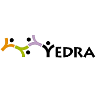

# Este es el titulo del trabajo
## Este es el subtitulo.
este es el **texto** donde se iran probando *los distintos modos* de letras por ejemplo ```negrita, cursiva o codigo```.  
1. podemos
2. hacer 
3. listas ordenadas  
como la anterior o desordenadas  
* como
* esta 
* otra  
[Enlace a la página web de yedra](https://yedra.educantabria.es/MODACC/)  
[enalce al ejercicio 1](ejercicio1.md)  
  
| Columna 1 | Columna 2 | Columna 3 |  
|-----------|-----------|-----------|   
| Dato 1    | Dato 2    | Dato 3    |  
| Dato 4    | Dato 5    | Dato 6    |