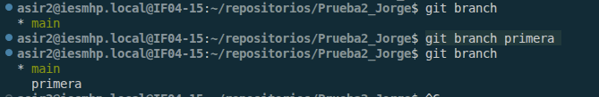
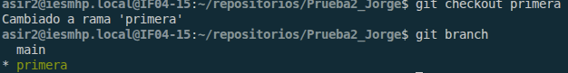
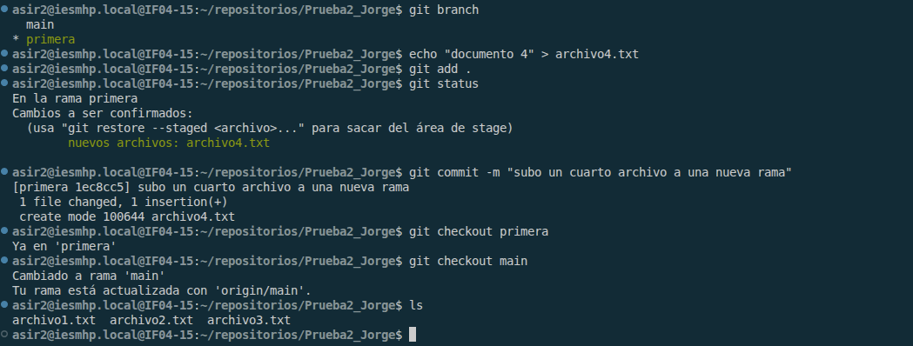
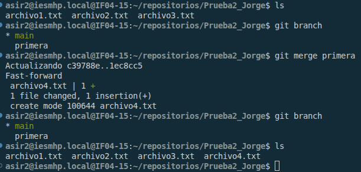
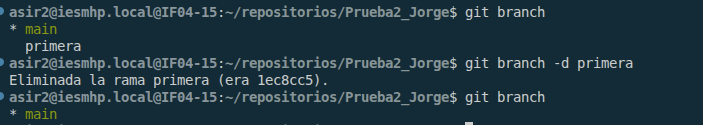
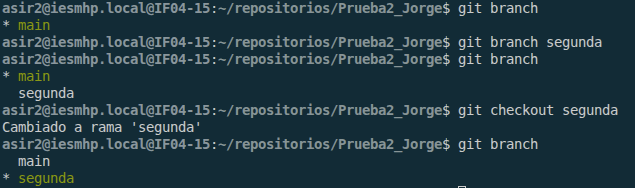
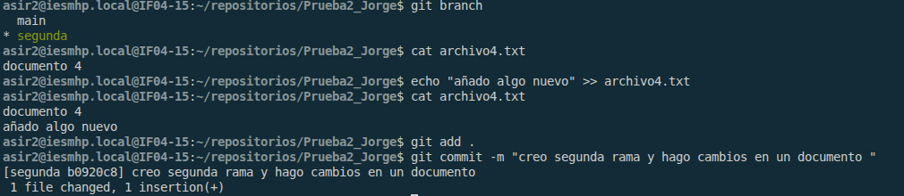
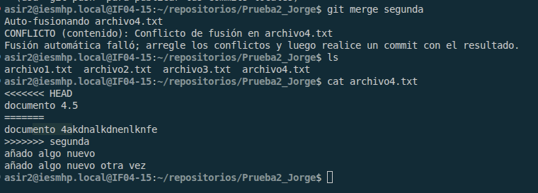
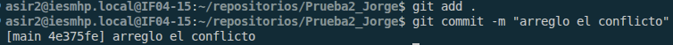
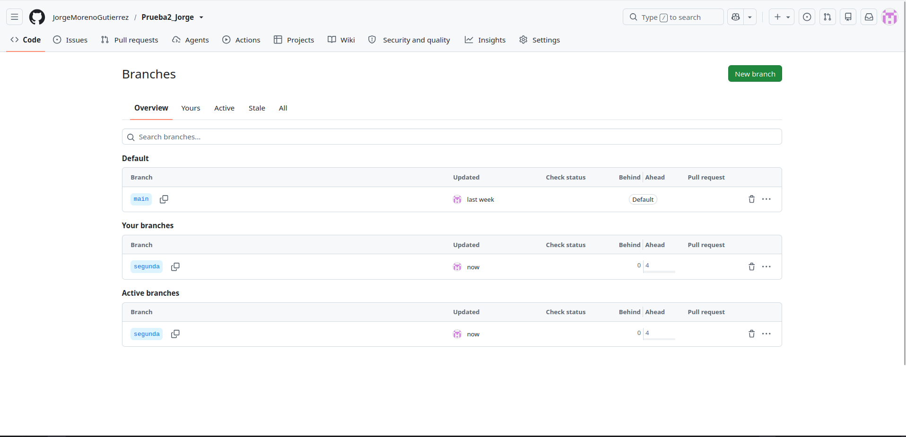

# EJERCICIO 3 iTrabajando con ramas y uniones.
#### paso1:  
lo primereo que tengo que hacer es crear una nueva rama llamada primera para ello usamos el comando **git branch primera**  
  
##### paso2:  
ahora nos **moveremos** a la nueva rama con **git checkout**  
 
ahora creamo un nuevo documento que solamene este en esta rama  
  
ahora fusionamos ambas ramas con el comando **git merge primera** estando situados en la rama main  
  
#### paso3:  
en este paso borraremos la rama **primera**  
  
#### paso4:  
creo una nueva rama y me muevo a ella
  
ahora desde la nueva rama modificamos un archivo ya creado para crear conflicto, nos aseguraremos que ambas ramas esten cerrados con commit.
  
asi nos aseguraremos que cuando hagamos el merge nos de un conflicto
  
#### paso5:
En el ultimo paso nos encargaremos de arreglar el conflcito en el docmento que se nos a abierto borraremos la parte que no queramos guadrdar.  
  
despues que lo arreglamos nos movemos a la rama segunda y lo subimos al repositorio remoto.
  