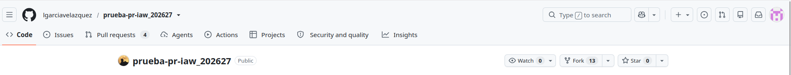
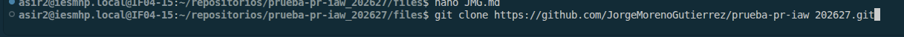
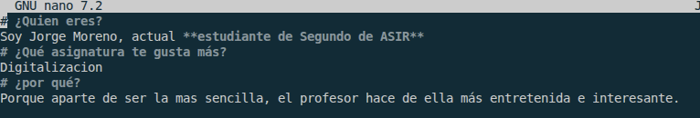
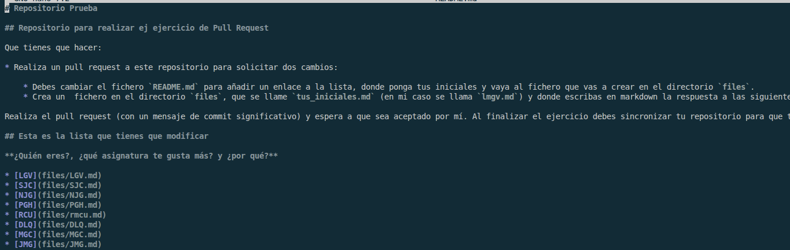
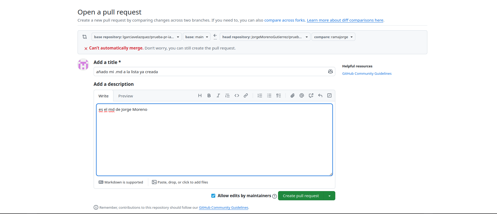
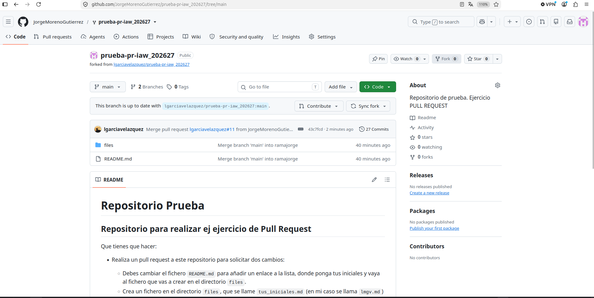

# EJERCICIO 4 ¿Cómo colaborar en un proyecto de software libre? ¿Qué es un Pull Request (PR)?
#### paso1:  
tendremos que crear un fork (es como descargarte una version del github ajeno en el tuyo) y ya desde ahi lo clonaremos como siempre con https
  
  
una vez clonado creamos una rama para identificarnos y hacemos ahi todo lo siguiente
  
una vez que estemos en nuestra rama nos iremos a files y crearemos un archivo de con el nombre **JMG.md** contestando a unas pregntas  
   
ahora nos vamos al **README.md** y añadimos un enlace a la lista
  
cuando acabemos todo esto haremos **git add. git commit -m git push -u origin nombre de la rama** y despues volvemos al github y hacemos un pull request.
  
despues volvemos al github y una vez nos acepten le damos a sync fork  

